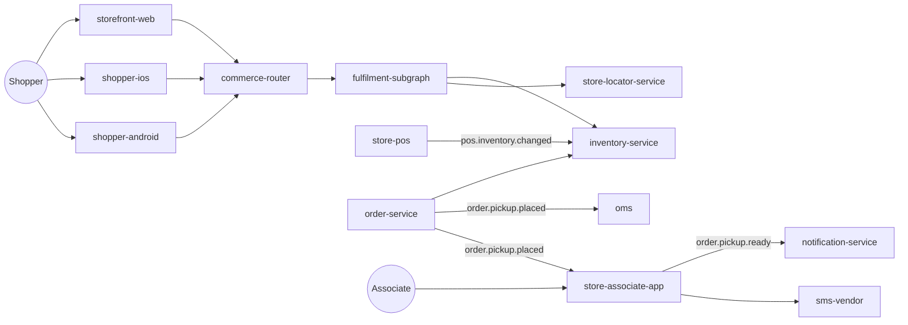
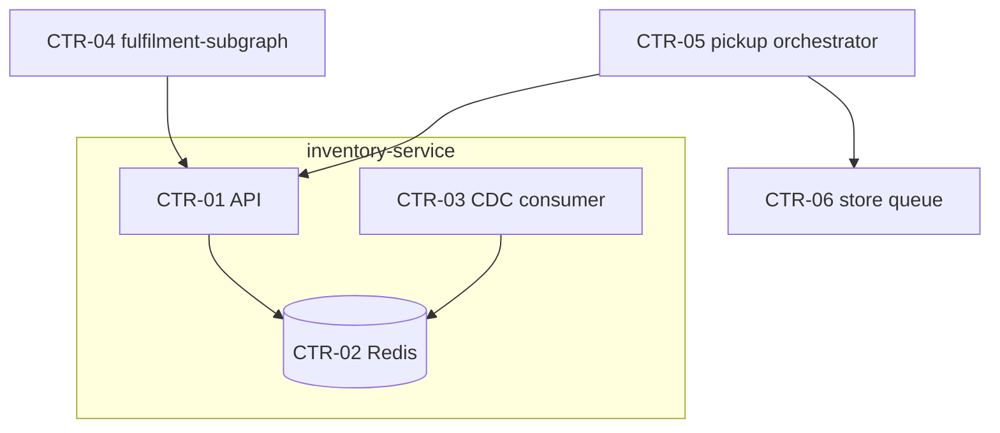

# Solution architecture (SAD + ADRs): WI-101

<h2 id="introduction_details" data-label="Introduction">Introduction</h2>

Solution architecture for BOPIS. Version 2 adds ADR-08 after KDD-02 was re-scored.

<h2 id="executive_summary_details" data-label="Executive Summary">Executive Summary</h2>

A new fulfilment subgraph gives web and apps one API for pickup availability. inventory-service keeps a Redis stock cache fed by POS stock changes over Kafka and holds soft reservations (DSP-01). order-service routes pickup orders to the store queue and OMS stays the system of record for orders.

<h2 id="system_context_details" data-label="System Context (C4 L1)">System Context (C4 L1)</h2>

Shoppers use storefront-web, shopper-ios and shopper-android, which call the commerce router. Associates use store-associate-app. store-pos publishes stock changes; oms holds orders; notification-service and an SMS vendor reach the shopper.

**Context diagram**

<h2 id="container_view_details" data-label="Containers (C4 L2)">Containers (C4 L2)</h2>

inventory-service gains a CDC consumer (CTR-03) and a Redis cache (CTR-02) behind its API (CTR-01). The fulfilment subgraph (CTR-04) resolves Product.pickupAvailability. order-service's pickup orchestrator (CTR-05) places, routes and auto-cancels pickup orders.

**Container diagram**

**Impacted Applications**

| Application | Change (New / Modify / Retire) | Responsibility | Owner |
|---|---|---|---|
| storefront-web | Modify | Shopper website | Web team |
| shopper-ios | Modify | iOS shopping app | Mobile team |
| shopper-android | Modify | Android shopping app | Mobile team |
| store-associate-app | Modify | Android handheld app in stores | Store tech team |
| commerce-router | Modify | Federated GraphQL router | API platform |
| fulfilment-subgraph | New | Pickup availability and store selection for all channels | Fulfilment team |
| inventory-service | Modify | Store stock cache, availability and reservations | Fulfilment team |
| order-service | Modify | Order capture, pickup orchestration | Order team |
| oms | Modify | Order management, system of record for orders | Enterprise apps |
| store-pos | Modify | Store point of sale; publishes stock changes | Store tech team |
| notification-service | Reuse | Push and email | Customer comms |
| store-locator-service | Reuse | Nearest stores by geo | Store tech team |
| sms-vendor | Reuse | External SMS gateway | Vendor |

**How the KDDs Are Applied**

| KDD ID | Decision | Where applied |
|---|---|---|
| KDD-01 | Event-sourced stock cache | inventory-service (CTR-02, CTR-03) |
| KDD-02 | Soft reservation | inventory-service (CTR-01) |
| KDD-03 | Federated subgraph | fulfilment-subgraph (CTR-04) |
| KDD-04 | Direct SMS vendor | store-associate-app backend (CTR-06) |

**Architecture Decision Records**

| ADR ID | Refines KDD | Decision | Status |
|---|---|---|---|
| ADR-07 | KDD-01 | Redis stock cache fed by POS CDC over Kafka | Accepted |
| ADR-08 | KDD-02 | Soft reservations with 15-minute TTL | Accepted |
| ADR-09 | KDD-03 | fulfilment-subgraph owns Store and extends Product | Accepted |

**Requirement Coverage**

| REQ ID | Containers | Notes |
|---|---|---|
| REQ-01 | CTR-01, CTR-02, CTR-03, CTR-04 |  |
| REQ-02 | CTR-04 |  |
| REQ-03 | CTR-01 |  |
| REQ-04 | CTR-05, CTR-06 |  |
| REQ-05 | CTR-06 |  |
| REQ-06 | CTR-06 |  |
| REQ-07 | CTR-05 |  |
| REQ-08 | store-associate-app (CTR-06) |  |

**Risks**

| Risk | Likelihood | Impact | Mitigation | Owner |
|---|---|---|---|---|
| RSK-01 Stock lag in stores with poor connectivity | Medium | High | Stale flag hides availability after 5 minutes | Arjun Mehta |
| RSK-02 Oversell during peak | Low | High | Atomic decrement in Redis, load test at 2× | Marcus Bell |
| RSK-03 Reservation drift with OMS | Medium | Medium | Nightly reconciliation job, PLAT-1423 | Marcus Bell |

**Traceability**

| Item | Traces to | Source artifact |
|---|---|---|
| APP-WEB | IMPACTED_BY WI-101 | A-REQUEST |
| APP-IOS | IMPACTED_BY WI-101 | A-REQUEST |
| APP-AND | IMPACTED_BY WI-101 | A-REQUEST |
| APP-STORE | IMPACTED_BY WI-101 | A-REQUEST |
| APP-GW | IMPACTED_BY WI-101 | A-REQUEST |
| APP-FULSG | IMPACTED_BY WI-101 | A-REQUEST |
| APP-INV | IMPACTED_BY WI-101 | A-REQUEST |
| APP-ORD | IMPACTED_BY WI-101 | A-REQUEST |
| APP-OMS | IMPACTED_BY WI-101 | A-REQUEST |
| APP-POS | IMPACTED_BY WI-101 | A-REQUEST |
| ADR-07 | REFINES KDD-01 | A-KDD |
| ADR-08 | REFINES KDD-02 | A-KDD |
| ADR-09 | REFINES KDD-03 | A-KDD |
| CTR-01 | SATISFIES REQ-01 | A-PRD |

**Open Questions**

| Question | Owner | Due | Status |
|---|---|---|---|
| None open | — | — | — |

**Approvals**

| Role | Name | Date | Decision |
|---|---|---|---|
| Architecture Review Board | ARB (chair: Arjun Mehta) | 2026-09-11 | Approved |

