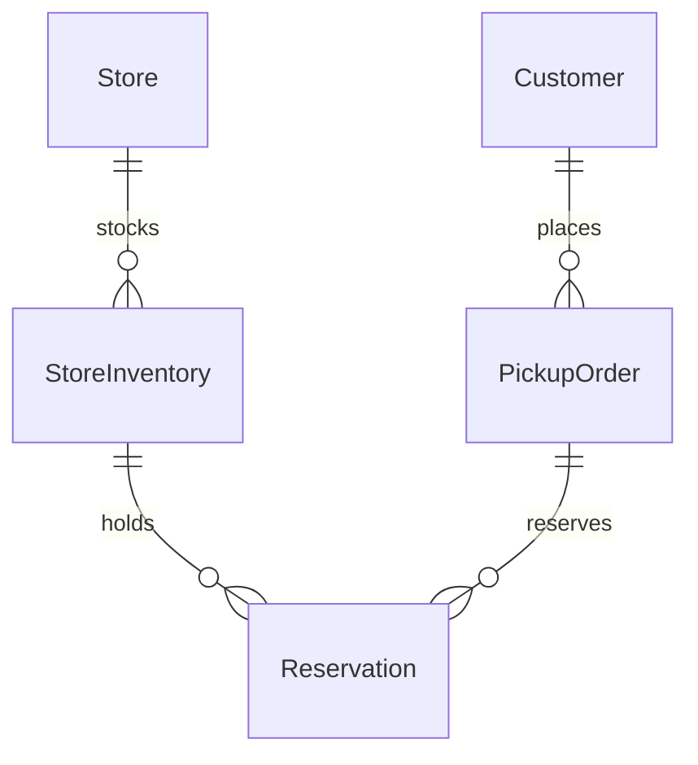

# Data model: WI-101

<h2 id="introduction_details" data-label="Introduction">Introduction</h2>

Logical model for store stock, reservations and pickup orders. StoreInventory is cached in inventory-service from store-pos; Reservation lives in inventory-service under DSP-01.

<div id="erd_block" data-label="Entity relationship diagram" data-format="mermaid">

**Entity relationship diagram**



</div>

<div id="entities_table" data-label="Entities" data-columns="Entity|Description|System of record|Owner app">

**Entities**

| Entity | Description | System of record | Owner app |
|---|---|---|---|
| StoreInventory | Stock per store and SKU | store-pos (cached in inventory-service) | inventory-service |
| Reservation | Soft hold of stock for a pickup order | inventory-service (DSP-01) | inventory-service |
| PickupOrder | Order to be collected in store | oms | oms |
| Store | Store with location and hours | store-locator-service | store-locator-service |
| Customer | Shopper contact details | customer-profile | order-service |

</div>

<div id="attributes_table" data-label="Attributes" data-columns="Entity|Attribute|Type|Nullable|Key|Classification|Retention">

**Attributes**

| Entity | Attribute | Type | Nullable | Key | Classification | Retention |
|---|---|---|---|---|---|---|
| StoreInventory | storeId | string | N | PK | Internal | — |
| StoreInventory | sku | string | N | PK | Internal | — |
| StoreInventory | onHand | int | N |  | Internal | — |
| StoreInventory | reserved | int | N |  | Internal | — |
| StoreInventory | available | int | N |  | Internal | — |
| StoreInventory | updatedAt | timestamp | N |  | Internal | — |
| Reservation | reservationId | uuid | N | PK | Internal | 90 days |
| Reservation | orderId | string | N | FK | Internal | 90 days |
| Reservation | qty | int | N |  | Internal | 90 days |
| Reservation | expiresAt | timestamp | N |  | Internal | 90 days |
| PickupOrder | orderId | string | N | PK | Internal | 7 years |
| PickupOrder | storeId | string | N | FK | Internal | 7 years |
| PickupOrder | status | enum | N |  | Internal | 7 years |
| PickupOrder | collectCode | string | N |  | Restricted | 30 days |
| Store | storeId | string | N | PK | Public | — |
| Store | distanceKm | decimal | Y |  | Public | — |
| Customer | phone | string | Y |  | Confidential | Account life |
| Customer | email | string | N |  | Confidential | Account life |

</div>

<div id="relationships_table" data-label="Relationships" data-columns="From|To|Cardinality|Notes">

**Relationships**

| From | To | Cardinality | Notes |
|---|---|---|---|
| Store | StoreInventory | 1:N | One row per SKU per store |
| StoreInventory | Reservation | 1:N | Reserved = sum of active reservations |
| PickupOrder | Reservation | 1:N | One reservation per order line |
| Customer | PickupOrder | 1:N | — |

</div>

<div id="definition_block" data-label="Data model (DBML)" data-format="dbml" data-src="docs/design-docs/WI-101/12-data-model.dbml">

**Data model (DBML)**

```dbml
Table store_inventory {
  store_id varchar [pk]
  sku varchar [pk]
  on_hand int
  reserved int
  available int
  updated_at timestamptz
}
Table reservation {
  reservation_id uuid [pk]
  order_id varchar
  store_id varchar
  sku varchar
  qty int
  expires_at timestamptz
  status varchar
}
Ref: reservation.(store_id, sku) > store_inventory.(store_id, sku)
```

</div>

<div id="traceability_table" data-label="Traceability" data-columns="Item|Traces to|Source artifact">

**Traceability**

| Item | Traces to | Source artifact |
|---|---|---|
| StoreInventory | OWNED_BY APP-INV | A-SAD |
| Reservation | OWNED_BY APP-INV | A-SAD |
| PickupOrder | OWNED_BY APP-OMS | A-SAD |
| Store | OWNED_BY APP-LOC | A-SAD |
| Customer | OWNED_BY APP-ORD | A-SAD |

</div>

<div id="open_questions_table" data-label="Open Questions" data-columns="Question|Owner|Due|Status">

**Open Questions**

| Question | Owner | Due | Status |
|---|---|---|---|
| None open | — | — | — |

</div>

<div id="approvals_table" data-label="Approvals" data-columns="Role|Name|Date|Decision">

**Approvals**

| Role | Name | Date | Decision |
|---|---|---|---|
| Data Governance Lead | Sofia Rossi | 2026-09-12 | Approved |

</div>

