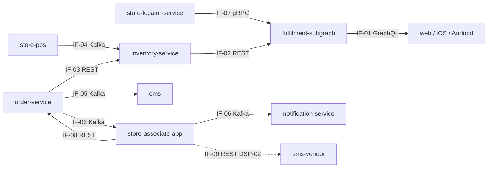

# Integration catalog: WI-101

<h2 id="introduction_details" data-label="Introduction">Introduction</h2>

Nine interfaces for BOPIS: two GraphQL, three REST, three Kafka and one gRPC, plus the vendor SMS call allowed by DSP-02. All are checked against the integration rules.

<div id="landscape_block" data-label="Integration landscape" data-format="mermaid">

**Integration landscape**



</div>

<div id="interfaces_table" data-label="Interfaces" data-columns="IF ID|Name|Pattern (REST / GraphQL / Kafka / gRPC)|Producer app|Consumer app|Sync / async|SLA|Spec file">

**Interfaces**

| IF ID | Name | Pattern (REST / GraphQL / Kafka / gRPC) | Producer app | Consumer app | Sync / async | SLA | Spec file |
|---|---|---|---|---|---|---|---|
| IF-01 | Pickup availability query | GraphQL | fulfilment-subgraph | storefront-web, shopper-ios, shopper-android | sync | p95 180 ms | contracts/graphql/WI-101/schema.graphql |
| IF-02 | Store availability API | REST | inventory-service | fulfilment-subgraph | sync | p95 150 ms | contracts/rest/WI-101/openapi.yaml |
| IF-03 | Reservation API | REST | inventory-service | order-service | sync | p99 400 ms | contracts/rest/WI-101/openapi.yaml |
| IF-04 | POS stock changes | Kafka | store-pos | inventory-service | async | lag ≤ 60 s | contracts/events/WI-101/events.avsc |
| IF-05 | Pickup order placed | Kafka | order-service | oms, store-associate-app | async | lag ≤ 30 s | contracts/events/WI-101/events.avsc |
| IF-06 | Pickup order ready | Kafka | store-associate-app | notification-service, order-service | async | lag ≤ 60 s | contracts/events/WI-101/events.avsc |
| IF-07 | Nearest stores | gRPC | store-locator-service | fulfilment-subgraph | sync | deadline 80 ms | proto/storelocator/v2/locator.proto |
| IF-08 | Collect pickup | REST | order-service | store-associate-app | sync | p95 300 ms | contracts/rest/WI-101/openapi.yaml |
| IF-09 | SMS send (vendor) | REST | store-associate-app | sms-vendor | sync | vendor 99.5% | vendor docs (DSP-02) |

</div>

<div id="rest_apis_table" data-label="REST APIs" data-columns="IF ID|Service|Method|Path|Purpose|OpenAPI file|Version|Auth">

**REST APIs**

| IF ID | Service | Method | Path | Purpose | OpenAPI file | Version | Auth |
|---|---|---|---|---|---|---|---|
| IF-02 | inventory-service | GET | /v1/stores/{storeId}/availability | Availability for SKUs at stores | contracts/rest/WI-101/openapi.yaml | 1.4.0 | OAuth2 (service) |
| IF-03 | inventory-service | POST | /v1/reservations | Create a soft reservation | contracts/rest/WI-101/openapi.yaml | 1.4.0 | OAuth2 (service) |
| IF-08 | order-service | POST | /v1/pickups/{orderId}/collect | Mark an order collected | contracts/rest/WI-101/openapi.yaml | 2.7.0 | OAuth2 (store device) |
| IF-09 | sms-vendor | POST | /messages | Send SMS (DSP-02) | vendor | v3 | API key |

</div>

<div id="graphql_operations_table" data-label="GraphQL Operations" data-columns="IF ID|Subgraph|Operation|Type (query / mutation)|Entities|SDL file|REST / gRPC source">

**GraphQL Operations**

| IF ID | Subgraph | Operation | Type (query / mutation) | Entities | SDL file | REST / gRPC source |
|---|---|---|---|---|---|---|
| IF-01 | fulfilment | storeAvailability | query | Store, Product | contracts/graphql/WI-101/schema.graphql | IF-02 REST, IF-07 gRPC |
| IF-01 | fulfilment | setPreferredStore | mutation | Store | contracts/graphql/WI-101/schema.graphql | customer-profile REST |

</div>

<div id="kafka_events_table" data-label="Kafka Events" data-columns="IF ID|Topic|Key|Schema subject|Compatibility|Producer|Consumers">

**Kafka Events**

| IF ID | Topic | Key | Schema subject | Compatibility | Producer | Consumers |
|---|---|---|---|---|---|---|
| IF-04 | pos.inventory.changed.v1 | storeId:sku | pos.inventory.changed.v1-value | BACKWARD | store-pos | inventory-service |
| IF-05 | order.pickup.placed.v1 | orderId | order.pickup.placed.v1-value | BACKWARD | order-service | oms, store-associate-app |
| IF-06 | order.pickup.ready.v1 | orderId | order.pickup.ready.v1-value | BACKWARD | store-associate-app | notification-service, order-service |

</div>

<div id="grpc_services_table" data-label="gRPC Services" data-columns="IF ID|Service|RPC|Proto file|Deadline ms">

**gRPC Services**

| IF ID | Service | RPC | Proto file | Deadline ms |
|---|---|---|---|---|
| IF-07 | store-locator-service | NearestStores | proto/storelocator/v2/locator.proto | 80 |

</div>

<div id="integration_rules_table" data-label="Integration Rule Checks" data-columns="Rule|Result (pass / fail)|Interfaces|Notes">

**Integration Rule Checks**

| Rule | Result (pass / fail) | Interfaces | Notes |
|---|---|---|---|
| A subgraph never calls another GraphQL service | pass | IF-01 | Uses REST and gRPC sources |
| Every Kafka topic has a BACKWARD-compatible schema | pass | IF-04, IF-05, IF-06 | — |
| Customer messages go through notification-service | fail (waived) | IF-09 | DSP-02, PLAT-1424 |
| Sync calls have a timeout below the caller's SLA | pass | IF-02, IF-03, IF-07 | — |

</div>

<div id="definition_block" data-label="Integration catalog definition (Data mapping Flows)" data-format="json" data-src="docs/design-docs/WI-101/13-integrations.json">

**Integration catalog definition (Data mapping Flows)**

```json
{
  "flows": [
    {
      "id": "IF-01",
      "name": "Pickup availability query",
      "pattern": "GraphQL",
      "producer": "fulfilment-subgraph",
      "consumers": [
        "storefront-web"
      ],
      "mode": "sync",
      "sla": "p95 180 ms",
      "spec": "contracts/graphql/WI-101/schema.graphql"
    },
    {
      "id": "IF-02",
      "name": "Store availability API",
      "pattern": "REST",
      "producer": "inventory-service",
      "consumers": [
        "fulfilment-subgraph"
      ],
      "mode": "sync",
      "sla": "p95 150 ms",
      "spec": "contracts/rest/WI-101/openapi.yaml"
    },
    {
      "id": "IF-03",
      "name": "Reservation API",
      "pattern": "REST",
      "producer": "inventory-service",
      "consumers": [
        "order-service"
      ],
      "mode": "sync",
      "sla": "p99 400 ms",
      "spec": "contracts/rest/WI-101/openapi.yaml"
    },
    {
      "id": "IF-04",
      "name": "POS stock changes",
      "pattern": "Kafka",
      "producer": "store-pos",
      "consumers": [
        "inventory-service"
      ],
      "mode": "async",
      "sla": "lag ≤ 60 s",
      "spec": "contracts/events/WI-101/events.avsc"
    },
    {
      "id": "IF-05",
      "name": "Pickup order placed",
      "pattern": "Kafka",
      "producer": "order-service",
      "consumers": [
        "oms"
      ],
      "mode": "async",
      "sla": "lag ≤ 30 s",
      "spec": "contracts/events/WI-101/events.avsc"
    },
    {
      "id": "IF-06",
      "name": "Pickup order ready",
      "pattern": "Kafka",
      "producer": "store-associate-app",
      "consumers": [
        "notification-service"
      ],
      "mode": "async",
      "sla": "lag ≤ 60 s",
      "spec": "contracts/events/WI-101/events.avsc"
    },
    {
      "id": "IF-07",
      "name": "Nearest stores",
      "pattern": "gRPC",
      "producer": "store-locator-service",
      "consumers": [
        "fulfilment-subgraph"
      ],
      "mode": "sync",
      "sla": "deadline 80 ms",
      "spec": "proto/storelocator/v2/locator.proto"
    },
    {
      "id": "IF-08",
      "name": "Collect pickup",
      "pattern": "REST",
      "producer": "order-service",
      "consumers": [
        "store-associate-app"
      ],
      "mode": "sync",
      "sla": "p95 300 ms",
      "spec": "contracts/rest/WI-101/openapi.yaml"
    },
    {
      "id": "IF-09",
      "name": "SMS send (vendor)",
      "pattern": "REST",
      "producer": "store-associate-app",
      "consumers": [
        "sms-vendor"
      ],
      "mode": "sync",
      "sla": "vendor 99.5%",
      "spec": "vendor docs (DSP-02)"
    }
  ],
  "rules": {
    "passed": 3,
    "waived": [
      "IF-09 (DSP-02)"
    ]
  }
}
```

</div>

<div id="traceability_table" data-label="Traceability" data-columns="Item|Traces to|Source artifact">

**Traceability**

| Item | Traces to | Source artifact |
|---|---|---|
| IF-01 | FROM APP-FULSG | A-SAD |
| IF-01 | TO APP-WEB | A-SAD |
| IF-02 | FROM APP-INV | A-SAD |
| IF-02 | TO APP-FULSG | A-SAD |
| IF-03 | FROM APP-INV | A-SAD |
| IF-03 | TO APP-ORD | A-SAD |
| IF-04 | FROM APP-POS | A-SAD |
| IF-04 | TO APP-INV | A-SAD |
| IF-05 | FROM APP-ORD | A-SAD |
| IF-05 | TO APP-OMS | A-SAD |
| IF-06 | FROM APP-STORE | A-SAD |
| IF-06 | TO APP-NOTIF | A-SAD |
| IF-07 | FROM APP-LOC | A-SAD |
| IF-07 | TO APP-FULSG | A-SAD |

</div>

<div id="open_questions_table" data-label="Open Questions" data-columns="Question|Owner|Due|Status">

**Open Questions**

| Question | Owner | Due | Status |
|---|---|---|---|
| None open | — | — | — |

</div>

<div id="approvals_table" data-label="Approvals" data-columns="Role|Name|Date|Decision">

**Approvals**

| Role | Name | Date | Decision |
|---|---|---|---|
| Integration Architect Lead | Tomás Silva | 2026-09-14 | Approved |

</div>

